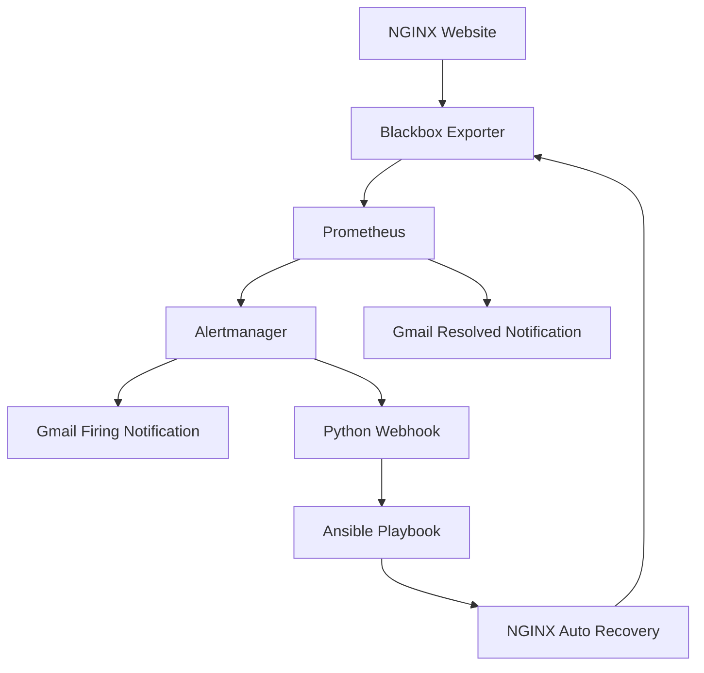

# Project Architecture

## Workflow
1. Blackbox Exporter checks the NGINX website.
2. Prometheus collects probe metrics.
3. When NGINX goes down, Prometheus generates an alert.
4. Alertmanager sends a Gmail notification and triggers the webhook.
5. Python webhook executes the Ansible recovery playbook.
6. Ansible ensures that NGINX is running.
7. Prometheus detects recovery and Alertmanager sends a resolved email.
